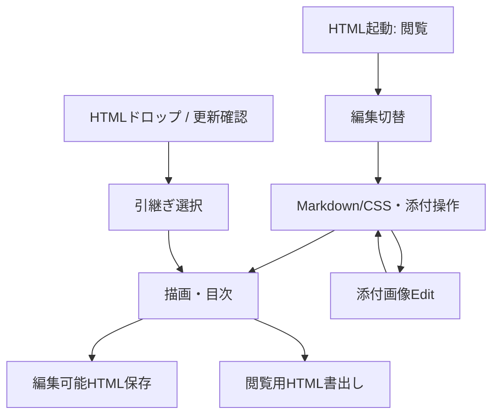

# 業務フロー

## 文書作成・閲覧
1. HTMLを開くと閲覧モードで原稿を表示する。メニューを開き「編集」またはESCで編集開始。
2. Markdown/CSSタブで入力する。自動同期ONならeditorのchange/keyup後300ms待機して描画。CSS編集は次のプレビュー時に反映。
3. 目次、見出しクリック/F2、テーマ、ペイン幅を利用する。メニューを閉じると編集から閲覧へ戻る。
4. Ctrl/Cmd+Sで編集可能HTML保存、Ctrl/Cmd+Shift+Sで閲覧用HTML書出し。後者は添付Blobを再埋込みしないので共有前に再開確認が必要。

## 添付・画像編集
ファイル選択/bodyへのドロップ、または専用paste-areaへの画像貼付→FileReader→fileList追加→タグ挿入→プレビュー。画像のEditからDrawerへ入り、矩形/文字/消去/Trimを操作。Saveでレイヤーと矩形情報を更新し復帰、Cancelは破棄。自由描画ペンはない。

## 取込・更新
HTMLのドロップ→fileListとeditor構造を検出→共用ダイアログで選択→添付追加・原稿末尾連結・CSS上書き。取消時はHTMLを通常添付する。
設定の更新リンク→警告承認→本家HTTP更新script取得→同版なら確認→共用ダイアログ→旧データ退避・HTML/script再構成→選択データ復元。無条件自動更新ではない。

環境判定はBlob生成失敗または旧Safari UA条件で警告・ツールバー無効化を行う。認可や不信文書の隔離機構ではない。
