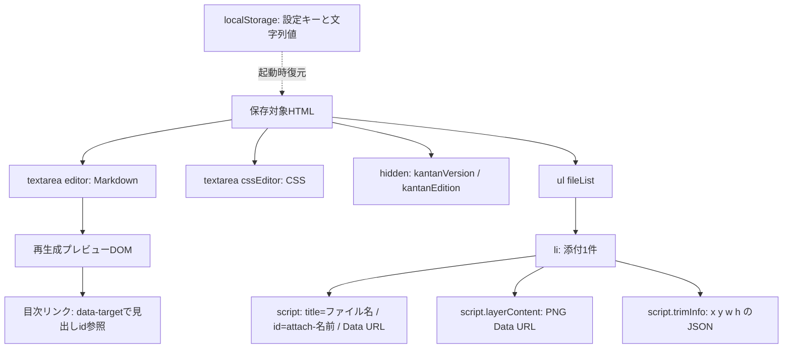

# ER図

## 適用範囲
RDBを使用しないため物理ER図・PK/FK・SQLカラム定義は存在しない。以下は実際のDOM・メモリの包含関係であり、架空のidやdocument_idは定義しない。

添付名は追加時に重複を検出し _2 等を付加する。リネーム時は空名・重複名を拒否するが、本文内のattach:参照を自動書換えする処理はない。KantanDrawerインスタンスは画面で共有され、添付ごとのDB行ではない。Diagram/Actor/Signalはライブラリ内の一時解析オブジェクトであり、永続化テーブルではない。
