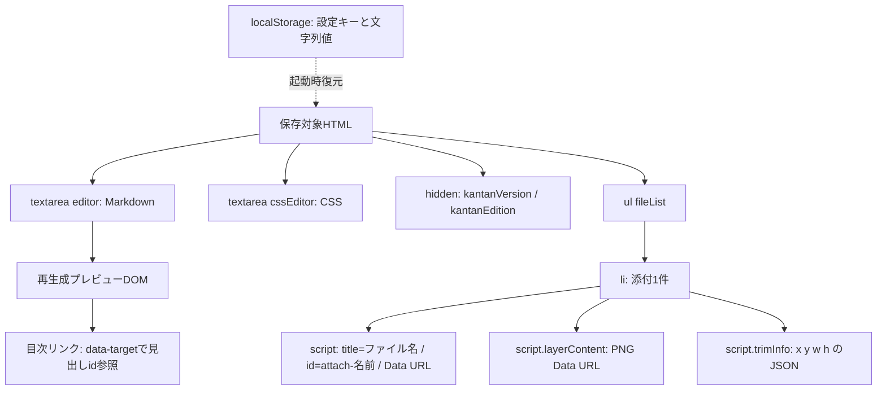

# ER図

## 適用範囲
RDBを使用しないため、物理ER図は定義しない。以下に保存HTML内の包含関係、表示データへの参照、および端末設定の読出し関係を示す。

添付名は追加時に重複を検出し _2 等を付加する。リネーム時は空名・重複名を拒否するが、本文内のattach:参照を自動書換えする処理はない。KantanDrawerインスタンスは画面で共有され、添付ごとのDB行ではない。Diagram/Actor/Signalはライブラリ内の一時解析オブジェクトであり、永続化テーブルではない。
