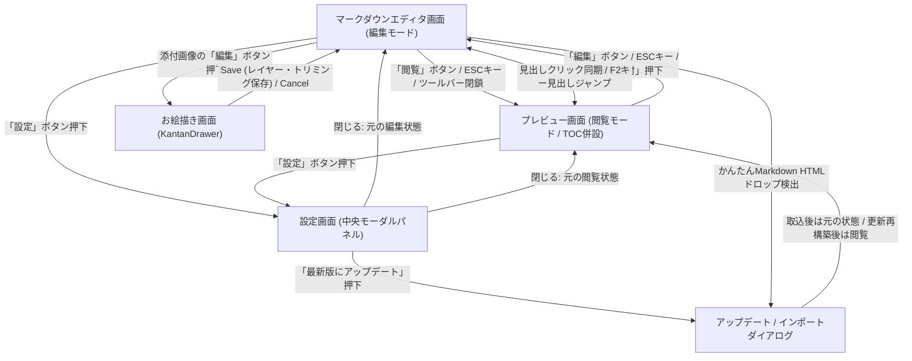

# 画面遷移

起動時の初期状態であるプレビュー画面（閲覧モード：SCR-002）およびマークダウンエディタ画面（編集モード：SCR-001）を基点として、目次（TOC）パネル開閉・見出しジャンプ、ドロワー形式でお絵描きを行うお絵描き画面（SCR-003）、ビューポート中央にモーダル表示される設定画面（SCR-005）、新バージョン適用時や他HTMLドロップ時に引き継ぎを行うアップデート/インポートダイアログ（SCR-004）との相互遷移を表しています。

**フロー:**
- プレビュー画面 → マークダウンエディタ画面 (ツールバー「編集」ボタン押下 / ESCキー /「画像を添付」ボタン押下)
- マークダウンエディタ画面 → プレビュー画面 (ツールバー「閲覧」ボタン押下 / ESCキー / ハンバーガーメニュー閉鎖時)
- プレビュー画面 ↔ プレビュー画面 (「目次」ボタン押下によるTOCパネル表示切替 / TOCリンククリックによる見出しスムーズスクロール / ダークモード切替)
- マークダウンエディタ画面 ↔ プレビュー画面 (編集モード時のプレビュー見出しクリック → エディタ該当行移動 / F2キー → プレビュー見出し移動)
- マークダウンエディタ画面 → お絵描き画面 (添付画像リストの「編集」(.editButton) 押下)
- お絵描き画面 → マークダウンエディタ画面 (Saveボタン押下によるレイヤー・トリミング反映 / Cancelボタン押下)
- マークダウンエディタ画面 / プレビュー画面 → 設定画面 (ツールバー「設定」(#btn-settings) ボタン押下)
- 設定画面 → マークダウンエディタ画面 / プレビュー画面 (「閉じる」(#btn-settings-close) 押下 / ESCキー)
- 設定画面 → アップデートダイアログ (「最新版にアップデート」(#updateButton) リンク押下)
- マークダウンエディタ画面 / プレビュー画面 → アップデートダイアログ (かんたんMarkdown形式HTMLファイルのドラッグ＆ドロップ検出時)
- アップデートダイアログ → マークダウンエディタ画面 / プレビュー画面 (引き継ぎ項目選択・OK押下による再構築/インポート完了 または キャンセル)

注：リアルタイム描画は画面遷移ではなく編集とプレビューの同時更新。HTML取込取消は元ファイルを通常添付する。更新再構築後は起動処理の閲覧状態となる。
