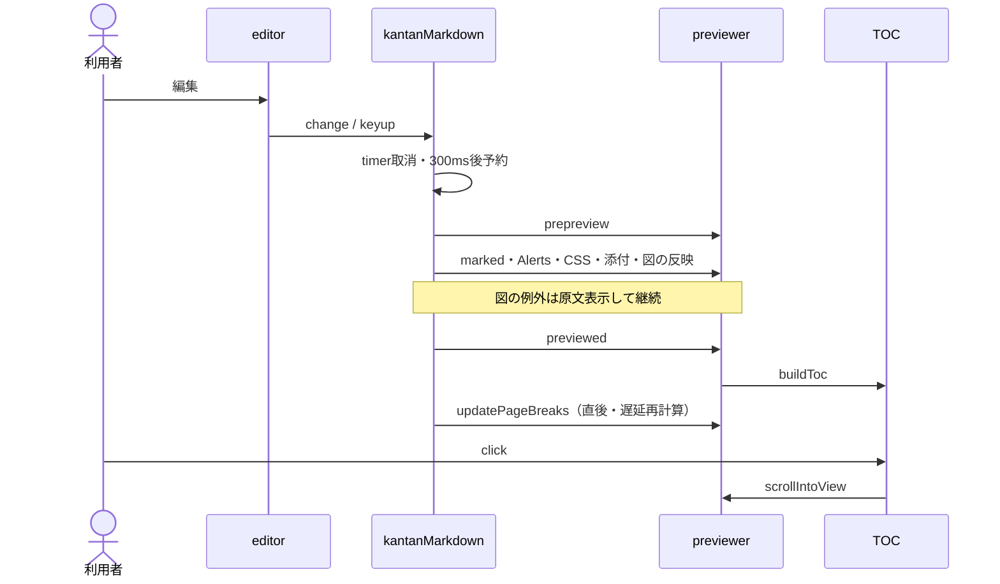
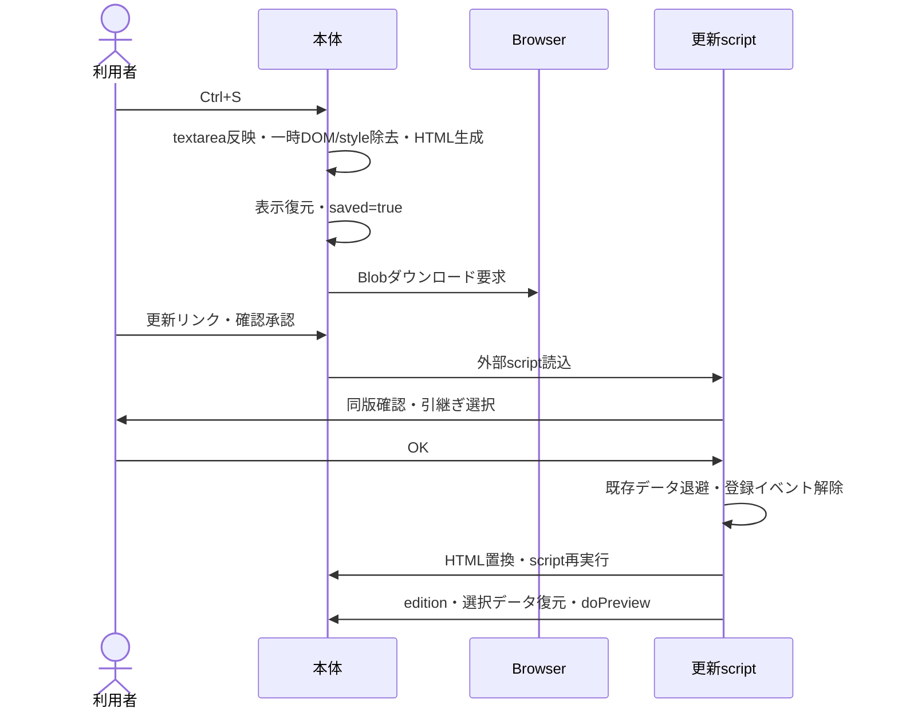
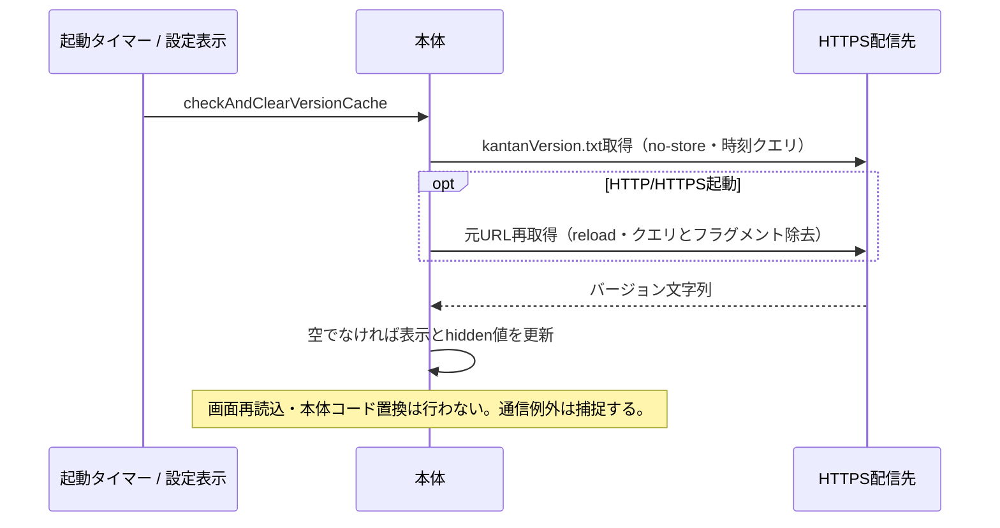

# シーケンス図

## 描画・目次

## 保存・更新

## バージョン情報取得

書出しはdoPreview後の描画DOM/CSS/目次を抽出する別経路で、添付Blobを再埋込みせず、非同期画像・図の完了も待機しない。画像Edit→drawer.show→Save→layerContent/trimInfo更新→キャッシュ破棄→doPreview。HTML取込取消は通常添付へ分岐する。
