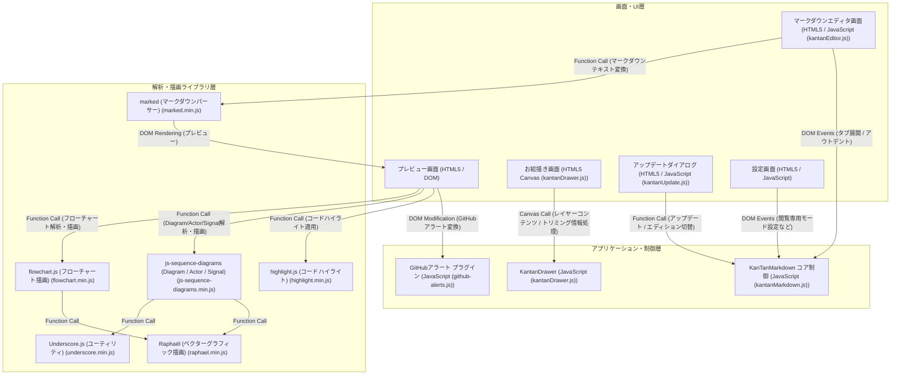

# アーキテクチャ構成図

単一HTML上で動作するマークダウンエディタおよびプレビューアのクライアントサイド・システム構成図

**画面・UI層:**
- マークダウンエディタ画面 [HTML5 / JavaScript (kantanEditor.js)]
- プレビュー画面 [HTML5 / DOM]
- お絵描き画面 [HTML5 Canvas (kantanDrawer.js)]
- アップデートダイアログ [HTML5 / JavaScript (kantanUpdate.js)]
- 設定画面 [HTML5 / JavaScript]

**アプリケーション・制御層:**
- KanTanMarkdown コア制御 [JavaScript (kantanMarkdown.js)]
- KantanDrawer [JavaScript (kantanDrawer.js)]
- GitHubアラート プラグイン [JavaScript (github-alerts.js)]

**解析・描画ライブラリ層:**
- marked (マークダウンパーサー) [marked.min.js]
- highlight.js (コードハイライト) [highlight.min.js]
- js-sequence-diagrams (Diagram / Actor / Signal) [js-sequence-diagrams.min.js]
- flowchart.js (フローチャート描画) [flowchart.min.js]
- Raphaël (ベクターグラフィック描画) [raphael.min.js]
- Underscore.js (ユーティリティ) [underscore.min.js]

**接続:**
- マークダウンエディタ画面 → KanTanMarkdown コア制御 (DOM Events (タブ展開 / アウトデント))
- マークダウンエディタ画面 → marked (マークダウンパーサー) (Function Call (マークダウンテキスト変換))
- marked (マークダウンパーサー) → プレビュー画面 (DOM Rendering (プレビュー))
- プレビュー画面 → GitHubアラート プラグイン (DOM Modification (GitHubアラート変換))
- プレビュー画面 → highlight.js (コードハイライト) (Function Call (コードハイライト適用))
- プレビュー画面 → js-sequence-diagrams (Diagram / Actor / Signal) (Function Call (Diagram/Actor/Signal解析・描画))
- プレビュー画面 → flowchart.js (フローチャート描画) (Function Call (フローチャート解析・描画))
- js-sequence-diagrams (Diagram / Actor / Signal) → Raphaël (ベクターグラフィック描画) (Function Call)
- flowchart.js (フローチャート描画) → Raphaël (ベクターグラフィック描画) (Function Call)
- js-sequence-diagrams (Diagram / Actor / Signal) → Underscore.js (ユーティリティ) (Function Call)
- お絵描き画面 → KantanDrawer (Canvas Call (レイヤーコンテンツ / トリミング情報処理))
- アップデートダイアログ → KanTanMarkdown コア制御 (Function Call (アップデート / エディション切替))
- 設定画面 → KanTanMarkdown コア制御 (DOM Events (閲覧専用モード設定など))

