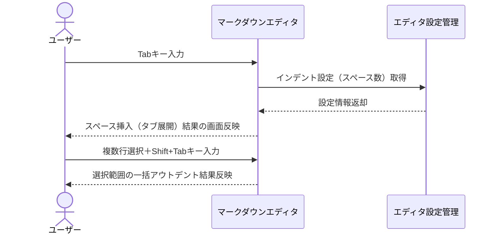
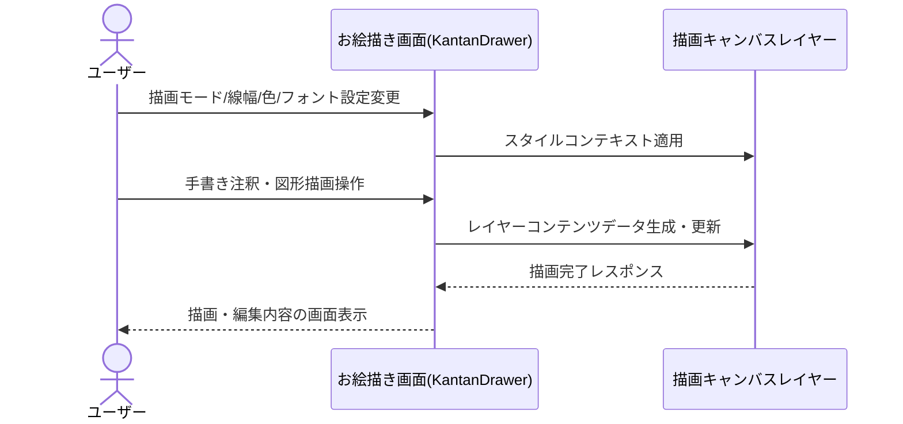
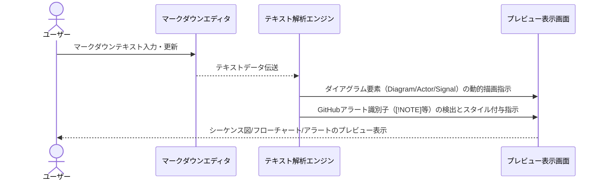
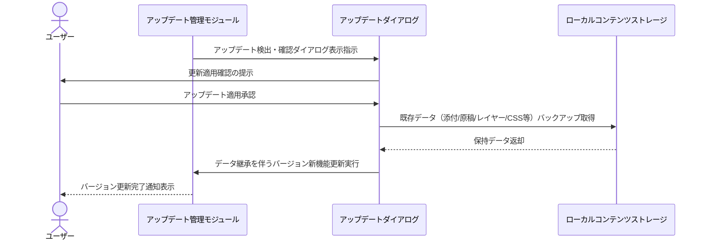
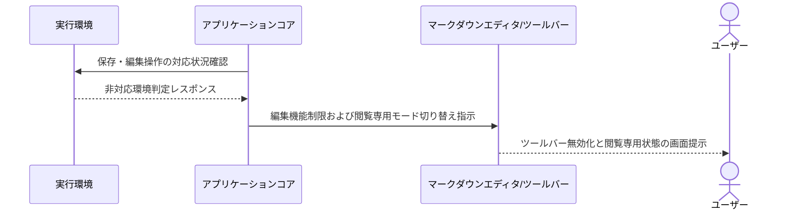

# 業務フロー

## テキスト編集

マークダウンエディタ画面におけるTabキーでのタブ展開およびShift+Tabキーでの複数行アウトデントの処理フロー

**参加者:** ユーザー (actor)、マークダウンエディタ (system)、エディタ設定管理 (database)

**メッセージフロー:**
- ユーザー → マークダウンエディタ: Tabキー入力
- マークダウンエディタ → エディタ設定管理: インデント設定（スペース数）取得
  - エディタ設定管理 ← マークダウンエディタ: 設定情報返却
  - マークダウンエディタ ← ユーザー: スペース挿入（タブ展開）結果の画面反映
- ユーザー → マークダウンエディタ: 複数行選択＋Shift+Tabキー入力
  - マークダウンエディタ ← ユーザー: 選択範囲の一括アウトデント結果反映

## グラフィック編集

お絵描き画面（KantanDrawer）でのスタイル設定変更および手書き注釈・図形の描画・編集処理フロー

**参加者:** ユーザー (actor)、お絵描き画面(KantanDrawer) (system)、描画キャンバスレイヤー (system)

**メッセージフロー:**
- ユーザー → お絵描き画面(KantanDrawer): 描画モード/線幅/色/フォント設定変更
- お絵描き画面(KantanDrawer) → 描画キャンバスレイヤー: スタイルコンテキスト適用
- ユーザー → お絵描き画面(KantanDrawer): 手書き注釈・図形描画操作
- お絵描き画面(KantanDrawer) → 描画キャンバスレイヤー: レイヤーコンテンツデータ生成・更新
  - 描画キャンバスレイヤー ← お絵描き画面(KantanDrawer): 描画完了レスポンス
  - お絵描き画面(KantanDrawer) ← ユーザー: 描画・編集内容の画面表示

## プレビュー表示

マークダウンテキストの動的解析によるダイアグラム（シーケンス図/フローチャート）描画およびGitHubアラート可視化フロー

**参加者:** ユーザー (actor)、マークダウンエディタ (system)、テキスト解析エンジン (system)、プレビュー表示画面 (system)

**メッセージフロー:**
- ユーザー → マークダウンエディタ: マークダウンテキスト入力・更新
- マークダウンエディタ → テキスト解析エンジン: テキストデータ伝送
- テキスト解析エンジン → プレビュー表示画面: ダイアグラム要素（Diagram/Actor/Signal）の動的描画指示
- テキスト解析エンジン → プレビュー表示画面: GitHubアラート識別子（[!NOTE]等）の検出とスタイル付与指示
  - プレビュー表示画面 ← ユーザー: シーケンス図/フローチャート/アラートのプレビュー表示

## データ管理

バージョンアップデート時の確認ダイアログ表示と既存コンテンツデータ継承・更新処理フロー

**参加者:** ユーザー (actor)、アップデート管理モジュール (system)、アップデートダイアログ (system)、ローカルコンテンツストレージ (database)

**メッセージフロー:**
- アップデート管理モジュール → アップデートダイアログ: アップデート検出・確認ダイアログ表示指示
- アップデートダイアログ → ユーザー: 更新適用確認の提示
- ユーザー → アップデートダイアログ: アップデート適用承認
- アップデートダイアログ → ローカルコンテンツストレージ: 既存データ（添付/原稿/レイヤー/CSS等）バックアップ取得
  - ローカルコンテンツストレージ ← アップデートダイアログ: 保持データ返却
- アップデートダイアログ → アップデート管理モジュール: データ継承を伴うバージョン新機能更新実行
  - アップデート管理モジュール ← ユーザー: バージョン更新完了通知表示

## 利用モード制御

非対応実行環境検知時のマークダウンエディタ編集機能制御および閲覧専用モード移行フロー

**参加者:** 実行環境 (external)、アプリケーションコア (system)、マークダウンエディタ/ツールバー (system)、ユーザー (actor)

**メッセージフロー:**
- アプリケーションコア → 実行環境: 保存・編集操作の対応状況確認
  - 実行環境 ← アプリケーションコア: 非対応環境判定レスポンス
- アプリケーションコア → マークダウンエディタ/ツールバー: 編集機能制限および閲覧専用モード切り替え指示
  - マークダウンエディタ/ツールバー ← ユーザー: ツールバー無効化と閲覧専用状態の画面提示

