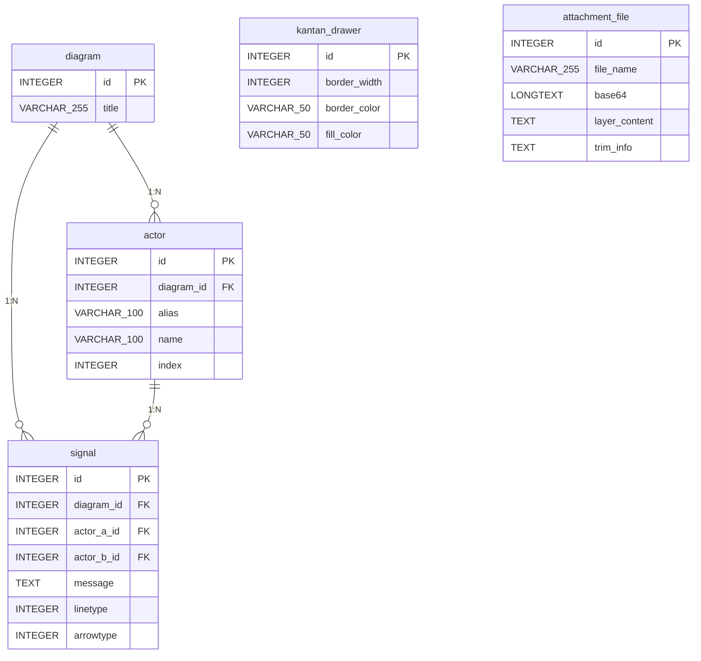

# ER図

KanTanMarkdownの主要機能（シーケンス図作成、ドロワー描画、添付ファイル管理）におけるデータ構造およびエンティティの関係を示したER図

### エンティティ一覧

**Diagram**

| カラム名 | データ型 | キー |
| --- | --- | --- |
| id | INTEGER | PK |
| title | VARCHAR(255) |  |

**Actor**

| カラム名 | データ型 | キー |
| --- | --- | --- |
| id | INTEGER | PK |
| diagram_id | INTEGER | FK |
| alias | VARCHAR(100) |  |
| name | VARCHAR(100) |  |
| index | INTEGER |  |

**Signal**

| カラム名 | データ型 | キー |
| --- | --- | --- |
| id | INTEGER | PK |
| diagram_id | INTEGER | FK |
| actor_a_id | INTEGER | FK |
| actor_b_id | INTEGER | FK |
| message | TEXT |  |
| linetype | INTEGER |  |
| arrowtype | INTEGER |  |

**KantanDrawer**

| カラム名 | データ型 | キー |
| --- | --- | --- |
| id | INTEGER | PK |
| border_width | INTEGER |  |
| border_color | VARCHAR(50) |  |
| fill_color | VARCHAR(50) |  |

**AttachmentFile**

| カラム名 | データ型 | キー |
| --- | --- | --- |
| id | INTEGER | PK |
| file_name | VARCHAR(255) |  |
| base64 | LONGTEXT |  |
| layer_content | TEXT |  |
| trim_info | TEXT |  |

### リレーション

- Diagram → Actor (1:N)
- Diagram → Signal (1:N)
- Actor → Signal (1:N)

### ER図

