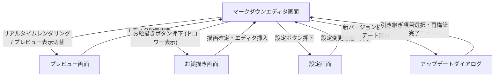

# 画面遷移

マークダウンエディタ画面（SCR-001）を基点として、リアルタイムレンダリングされるプレビュー画面（SCR-002）、ドロワー形式でお絵描きを行うお絵描き画面（SCR-003）、エディタの動作オプションを設定する設定画面（SCR-005）、新バージョン適用時に引き継ぎを行うアップデートダイアログ（SCR-004）との相互遷移を表しています。

**フロー:**
- マークダウンエディタ画面 → プレビュー画面 (リアルタイムレンダリング / プレビュー表示切替)
- プレビュー画面 → マークダウンエディタ画面 (エディタ編集再開)
- マークダウンエディタ画面 → お絵描き画面 (お絵描きボタン押下 (ドロワー表示))
- お絵描き画面 → マークダウンエディタ画面 (描画確定・エディタ挿入)
- マークダウンエディタ画面 → 設定画面 (設定ボタン押下)
- 設定画面 → マークダウンエディタ画面 (設定変更適用・完了)
- マークダウンエディタ画面 → アップデートダイアログ (新バージョン検出 / アップデート実行)
- アップデートダイアログ → マークダウンエディタ画面 (引き継ぎ項目選択・再構築完了)

