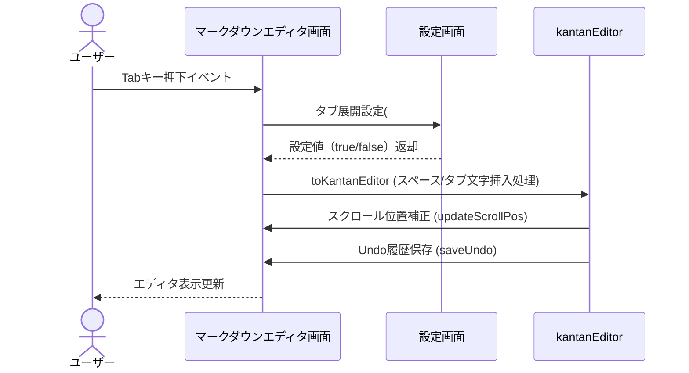
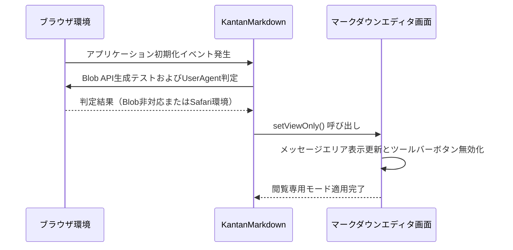
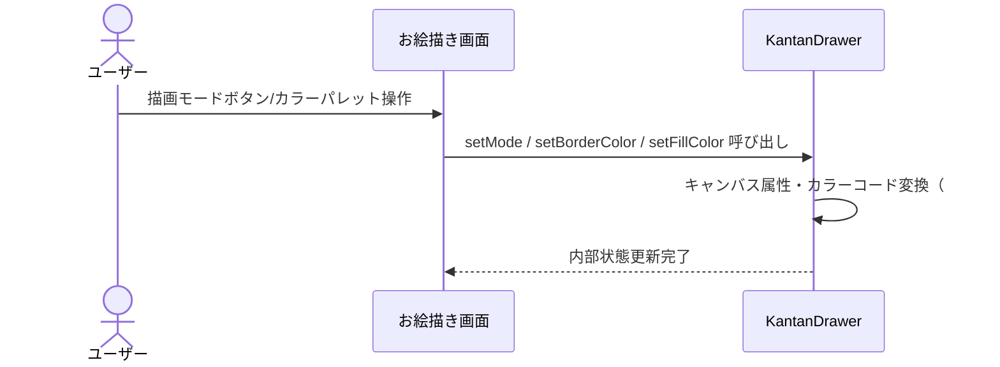
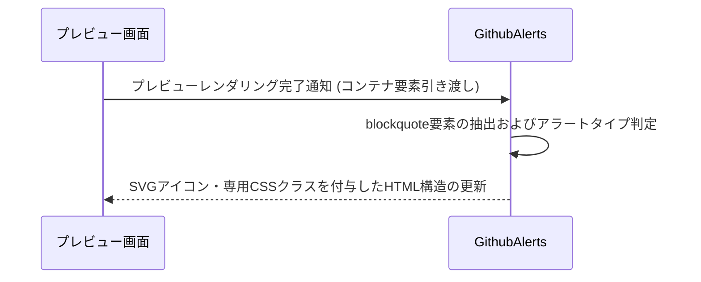
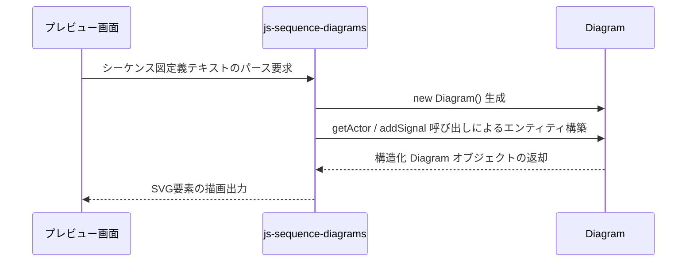
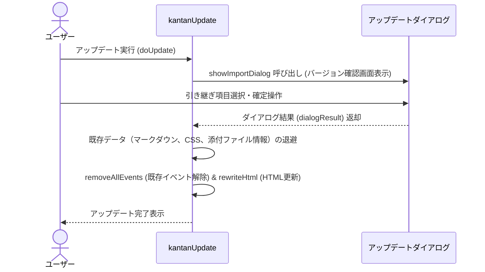

# シーケンス図

## エディタ制御

マークダウンエディタ画面でのTabキー操作時に設定画面のタブ展開フラグを参照し、スペース挿入またはタブ文字挿入を行ってスクロール位置とUndo履歴を更新する。

**参加者:** ユーザー (actor)、マークダウンエディタ画面 (system)、設定画面 (system)、kantanEditor (system)

**メッセージフロー:**
- ユーザー → マークダウンエディタ画面: Tabキー押下イベント
- マークダウンエディタ画面 → 設定画面: タブ展開設定(#setting-expand-tab)の確認
  - 設定画面 ← マークダウンエディタ画面: 設定値（true/false）返却
- マークダウンエディタ画面 → kantanEditor: toKantanEditor (スペース/タブ文字挿入処理)
- kantanEditor → マークダウンエディタ画面: スクロール位置補正 (updateScrollPos)
- kantanEditor → マークダウンエディタ画面: Undo履歴保存 (saveUndo)
  - マークダウンエディタ画面 ← ユーザー: エディタ表示更新

## ブラウザ互換・アクセス制御

アプリケーション初期化時にブラウザのBlobサポートおよびUserAgentを検証し、非対応環境の場合は閲覧専用モードを適用して操作を制限する。

**参加者:** ブラウザ環境 (system)、KantanMarkdown (system)、マークダウンエディタ画面 (system)

**メッセージフロー:**
- ブラウザ環境 → KantanMarkdown: アプリケーション初期化イベント発生
- KantanMarkdown → ブラウザ環境: Blob API生成テストおよびUserAgent判定
  - ブラウザ環境 ← KantanMarkdown: 判定結果（Blob非対応またはSafari環境）
- KantanMarkdown → マークダウンエディタ画面: setViewOnly() 呼び出し
- マークダウンエディタ画面 → マークダウンエディタ画面: メッセージエリア表示更新とツールバーボタン無効化
  - マークダウンエディタ画面 ← KantanMarkdown: 閲覧専用モード適用完了

## 画像・描画編集

お絵描き画面における描画モード切り替えや枠線色・塗りつぶし色の変更イベントを検知し、KantanDrawerの内部状態を更新する。

**参加者:** ユーザー (actor)、お絵描き画面 (system)、KantanDrawer (system)

**メッセージフロー:**
- ユーザー → お絵描き画面: 描画モードボタン/カラーパレット操作
- お絵描き画面 → KantanDrawer: setMode / setBorderColor / setFillColor 呼び出し
- KantanDrawer → KantanDrawer: キャンバス属性・カラーコード変換（#hex / rgba）保持
  - KantanDrawer ← お絵描き画面: 内部状態更新完了

## マークダウン拡張

マークダウンパース後のHTML要素から[!NOTE]などの記述を持つブロック引用を検索し、GitHubスタイルのアラート構造へ動的に変換する。

**参加者:** プレビュー画面 (system)、GithubAlerts (system)

**メッセージフロー:**
- プレビュー画面 → GithubAlerts: プレビューレンダリング完了通知 (コンテナ要素引き渡し)
- GithubAlerts → GithubAlerts: blockquote要素の抽出およびアラートタイプ判定
  - GithubAlerts ← プレビュー画面: SVGアイコン・専用CSSクラスを付与したHTML構造の更新

## 図表レンダリング

マークダウンテキスト内の sequence コードブロックをパースし、Diagram/Actor/Signal エンティティを生成してプレビュー画面に描画する。

**参加者:** プレビュー画面 (system)、js-sequence-diagrams (system)、Diagram (system)

**メッセージフロー:**
- プレビュー画面 → js-sequence-diagrams: シーケンス図定義テキストのパース要求
- js-sequence-diagrams → Diagram: new Diagram() 生成
- js-sequence-diagrams → Diagram: getActor / addSignal 呼び出しによるエンティティ構築
  - Diagram ← js-sequence-diagrams: 構造化 Diagram オブジェクトの返却
  - js-sequence-diagrams ← プレビュー画面: SVG要素の描画出力

## アプリケーション更新

新バージョンの検出時にアップデートダイアログを表示し、ユーザーが選択した引継ぎ項目（エディタ内容・添付ファイル・CSS等）を保持したままアプリケーション構造を差し替える。

**参加者:** ユーザー (actor)、kantanUpdate (system)、アップデートダイアログ (system)

**メッセージフロー:**
- ユーザー → kantanUpdate: アップデート実行 (doUpdate)
- kantanUpdate → アップデートダイアログ: showImportDialog 呼び出し (バージョン確認画面表示)
- ユーザー → アップデートダイアログ: 引き継ぎ項目選択・確定操作
  - アップデートダイアログ ← kantanUpdate: ダイアログ結果 (dialogResult) 返却
- kantanUpdate → kantanUpdate: 既存データ（マークダウン、CSS、添付ファイル情報）の退避
- kantanUpdate → kantanUpdate: removeAllEvents (既存イベント解除) & rewriteHtml (HTML更新)
  - kantanUpdate ← ユーザー: アップデート完了表示

